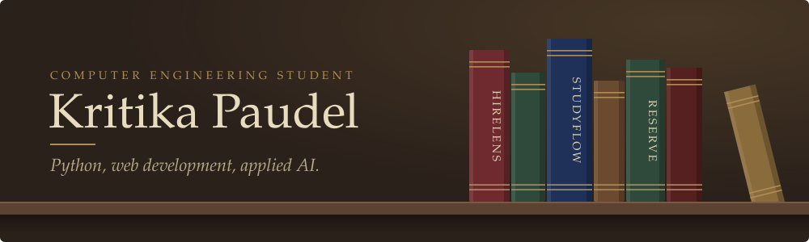

  

I'm a computer engineering student who likes taking a half-formed idea and turning it into something that actually runs. Most of my time goes into Python backends, small web apps, and working out where AI is genuinely useful and where it's just decoration.

  
  

| Title | Description | Language |
|---|---|---|
| **[HireLens](https://github.com/kri3377)** | Analyses interview responses and matches resumes against job descriptions. I worked on the AI integration, backend API, and database layer. | Python |
| **[StudyFlow](https://github.com/kri3377)** | Study and task planner for keeping coursework under control. | Next.js |
| **[Reserve](https://github.com/kri3377)** | Event management system with booking and admin flows. | Flask |
| **Phishing Detector** | Early concept for flagging suspicious emails and URLs. | Python |

  

  

